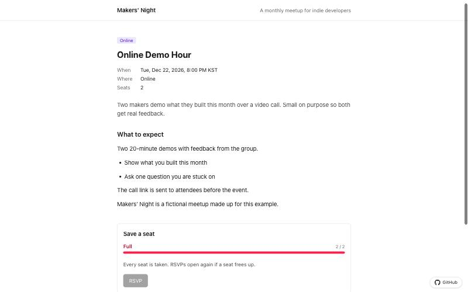

<!--
초안입니다. 숫자와 장면은 모두 docs/BUILD_LOG.md에 적힌 실제 값입니다.
게시 전에 채울 것:
- 02-webhook-settings.png, 06-dashboard-edit-no-event.png (대시보드 캡처)
- 03-rsvp-seats.gif (두 탭 녹화)
- "대시보드 수정은 Webhook이 오지 않는다"는 아직 문서 내용일 뿐, 직접 확인하지 않았습니다.
- 01-ai-design.png는 없습니다. 테이블을 MCP로 만들어 AI 설계를 돌리지 않았습니다.
-->

밋업 신청 폼을 만들었습니다. 로그인 없이 이름과 이메일만 적으면 자리가 잡히고, 정원이 차면 닫힙니다. DB도 알림 서버도 만들지 않았습니다. Onttle 테이블 두 개와 Next.js Route Handler 하나가 전부입니다.

- 데모: https://example.onttle.com/event-rsvp
- 코드: https://github.com/onttle/onttle-examples/tree/main/event-rsvp

이번 편은 시리즈에서 처음으로 **Onttle이 우리 서버를 부르는** 예제입니다. 지금까지는 앱이 Onttle을 부르기만 했습니다. 방향이 바뀌니 새로 챙길 것이 세 가지 생겼습니다. Webhook은 한 번만 오고, 어떤 변경은 아예 오지 않고, 마지막 한 자리는 여러 명이 동시에 가져갈 수 있습니다.

"Makers' Night"는 이 예제를 위해 지어낸 가상의 밋업입니다.

## 구성

| 무엇 | 어디에 |
| --- | --- |
| 일정 | Onttle `events` 테이블 |
| 신청 | Onttle `registrations` 테이블. `event` 컬럼이 REFERENCE로 일정을 가리킴 |
| 좌석 수 | 신청 행을 서버에서 세어 60초 캐시 |
| 좌석 변동 알림 | Onttle Webhook `rsvp-seats` → `POST /api/webhooks/onttle` |

신청에는 이름과 이메일이 들어 있습니다. 그래서 `registrations`는 읽기까지 **Secret key only**로 잠갔고, 모든 호출은 서버에서 시크릿 키로 합니다. 브라우저는 Onttle을 직접 부르지 않습니다. 권한 규칙의 기본 읽기 값은 public이라, 이 설정을 빼먹으면 게시용 키만 있어도 모든 이메일을 읽을 수 있습니다.

## REFERENCE는 보낼 때와 받을 때 모양이 다르다

요청에는 가리킬 행의 id 문자열을 넣습니다.

```json
{ "event": "9f59d161-…", "name": "…", "email": "…", "is_publish": true }
```

응답에는 객체로 돌아옵니다.

```json
{ "event": { "tableId": "events", "uuid": "9f59d161-…" } }
```

`tableId`라는 이름과 달리 테이블 slug가 들어 있습니다. 같은 값을 MCP 도구로 읽으면 id 문자열만 보입니다. 에이전트가 MCP에서 본 모양만 믿고 코드를 짰다면 REST 응답에서 좌석 수가 전부 0이 됐을 것입니다. 이번에는 두 모양을 모두 받도록 짜 두어서, 실제 응답을 확인한 뒤에도 코드를 고칠 일이 없었습니다.

REFERENCE 컬럼은 필터가 되지 않습니다. `filter[event]=<id>`를 붙이면 오류 없이 무시되고 전체 행이 옵니다. 그래서 "이 일정의 신청 수"는 전부 읽어서 앱에서 셉니다.

## Webhook은 한 번만 온다

Onttle 문서에 적힌 제약은 두 가지입니다.

- 이벤트는 한 번 보내고 재시도하지 않습니다.
- 대시보드에서 고친 내용은 이벤트를 보내지 않습니다.

Webhook만 믿으면 한 번 놓친 순간부터 좌석 수가 계속 틀립니다. 그래서 좌석 캐시에 **60초 재검증**을 같이 걸었습니다. Webhook은 빠른 길이고, 60초는 안전망입니다.

직접 재 보니 이렇습니다.

| 상황 | Webhook | 화면 반영 |
| --- | --- | --- |
| 사이트 폼으로 신청 (REST) | 옴. 행 생성 후 0.40–0.65초, 4건 모두 200 | 즉시 |
| MCP로 행 추가 | **안 옴** | 60초 재검증으로 (95초 뒤 확인) |
| MCP로 행 삭제 | **안 옴** | 60초 재검증으로 |
| 대시보드 수정 | 문서상 안 옴 (미확인) | — |

MCP 쓰기는 문서의 "안 오는 경우" 목록에 없었지만 실제로 오지 않았습니다. 주최자가 AI 에이전트로 신청을 정리하는 경우가 딱 여기에 해당합니다. 안전망이 없었다면 그 변경은 사이트에 영영 반영되지 않았을 것입니다.

한 가지 더. `registrations`의 삭제 엔드포인트를 꺼 두었기 때문에 **DELETED 이벤트는 이번 빌드에서 한 번도 실제로 오지 않았습니다.** 구독은 해 두었지만 검증은 서명 테스트뿐입니다.

## 서명은 원문으로 검증한다

수신 주소는 공개 URL이라 누구나 POST를 보낼 수 있습니다. Onttle은 `X-Onttle-Signature: t=<초>,v1=<hex>` 헤더를 붙이고, 받는 쪽은 `{t}.{본문}`의 HMAC-SHA256을 서명 키로 계산해 비교합니다. 본문은 JSON으로 파싱하기 전의 원문이어야 합니다. 파싱했다가 다시 직렬화하면 공백 하나로도 서명이 달라집니다.

틀린 서명을 보내면 이렇게 돌아옵니다.

```
HTTP/2 401
content-type: application/json
{"ok":false}
```

| 요청 | 응답 |
| --- | --- |
| 올바른 서명 | 200 |
| 서명 후 본문 변경 | 401 |
| 10분 지난 타임스탬프 | 401 |
| 서명 없음 | 401 |

서명 키는 Webhook을 만든 뒤 대시보드에서만 볼 수 있습니다. MCP로 Webhook을 등록해도 키는 돌려주지 않습니다.

## 마지막 한 자리를 세 명이 동시에 누르면

Onttle에는 트랜잭션도 조건부 쓰기도 없습니다. 신청 액션은 쓰기 직전에 좌석을 다시 세지만, 두 요청이 같은 순간에 세면 둘 다 "한 자리 남음"을 봅니다.

1석 남은 워크숍에 신청 3건을 같은 초에 보냈습니다. **3건 모두 저장됐습니다.** 행 세 개가 0.25초 안에 만들어졌습니다.

막을 수는 없으니 쓴 뒤에 한 번 더 셉니다. 생성 시각 순서로 자기 행이 정원 안인지 보고, 밖이면 완료 화면에서 그대로 알립니다.

- 첫 번째: "You're in"
- 나머지 둘: "saved beyond the seat limit, not a confirmed seat"

정원을 넘긴 신청을 지우지 않고 남겨 두는 쪽을 골랐습니다. 주최자가 대기자로 쓸 수 있고, 신청자에게 거짓 확정을 주지 않는 것이 더 중요하다고 봤습니다.

## 에이전트가 틀린 곳

Claude Code로 만들었고, 틀린 곳은 네 군데입니다.

1. **없는 기능을 선택지로 냈습니다.** "시크릿 키를 MCP로 발급"을 제안했는데, MCP는 게시용 키만 발급합니다. 도구 설명을 읽기 전에 물었습니다.
2. **`"use server"` 파일에서 상수를 export했습니다.** 첫 빌드 전에 발견해 옮겼습니다.
3. **지난 일정에도 신청 폼을 보여 줬습니다.** 액션은 거절하지만 화면은 열려 있었습니다.
4. **JavaScript 없이 신청하면 완료 화면이 404였습니다.** 신청은 저장되는데 리다이렉트에 basePath가 빠졌습니다. Next 16.4는 Server Action의 리다이렉트에 basePath를 fetch 요청일 때만 붙입니다. 브라우저 점검은 전부 JavaScript가 켜져 있어 통과했고, 동시 신청 테스트가 curl로 폼을 보내면서 드러났습니다.

4번이 가장 배울 만했습니다. 한계를 재려고 만든 테스트가 전혀 다른 버그를 찾았습니다.

도구 쪽 문제도 하나 있었습니다. MCP `create_table`로는 REFERENCE 컬럼이 `invalidReferenceTableId`로 두 번 실패했고, 컬럼 없이 테이블을 만든 뒤 `update_table`로 추가하니 같은 값으로 됐습니다.

## 숫자

| 항목 | 값 |
| --- | --- |
| 테이블 / 컬럼 | 2개 / 12개 |
| 서명 테스트 | 8건 통과 |
| 실제 Webhook 전달 | 4건, 모두 200, 0.40–0.65초 |
| 1석에 동시 신청 3건 | 3건 저장 |
| Vercel 배포 | event-rsvp 4회 (실패 0), 게이트웨이 1회 |



## 정리

- 개인정보가 든 테이블은 읽기 규칙부터 잠급니다. 기본값은 public입니다.
- Webhook에는 주기적 재검증을 같이 겁니다. 재시도가 없고, MCP와 대시보드 변경은 오지 않습니다.
- 정원은 막을 수 없으니 쓴 뒤에 다시 세고, 넘친 사람에게 사실대로 알립니다.
- basePath 아래의 폼은 JavaScript를 끄고도 한 번 보내 봅니다.
